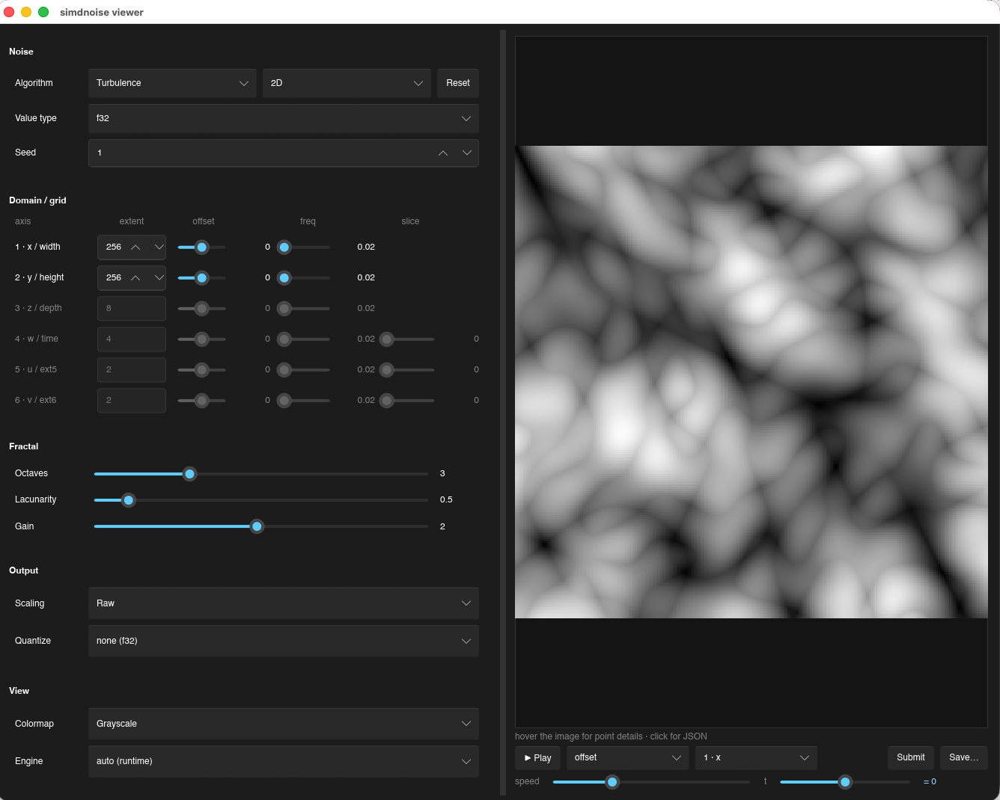

# SIMDNoise
[](https://crates.io/crates/simdnoise) [](https://docs.rs/simdnoise)

Super fast SIMD noise library for Rust. PRs welcome!
This library was created by Jack Mott.
The current maintainer is Peter Reijnders.

## Features

* Gradient Noise (Simplex aka Perlin) 1D,2D,3D,4D, and **5D/6D (experimental)**
* Fractal Brownian Motion, Ridge, and Turbulence
* Cellular Noise (aka Voroni) 1D,2D,3D,4D, and **5D/6D (experimental)**
* `f32` and `f64` output for every algorithm and dimension
* SSE2, SSE41, AVX2, and AVX-512 instruction sets, plus NEON and a non-SIMD fallback
* AVX2 version also leverages FMA3
* Runtime detection picks the best available instruction set
* Provide a seed value to randomize your noise result

### Capability matrix

What is implemented, per algorithm and dimension. `v` = implemented & working,
blank = not applicable. Entries marked `v*` are **experimental** (see below).

| Algorithm | knobs | 1D | 2D | 3D | 4D | 5D | 6D |
|---|---|:--:|:--:|:--:|:--:|:--:|:--:|
| Gradient (raw Simplex) | seed, freq | v | v | v | v | v* | v* |
| FBM | + lacunarity, gain, octaves | v | v | v | v | v* | v* |
| Ridge | + lacunarity, gain, octaves | v | v | v | v | v* | v* |
| Turbulence | + lacunarity, gain, octaves | v | v | v | v | v* | v* |
| Cellular (Voronoi F1) | seed, freq, distance_fn, return_type, jitter | v | v | v | v | v* | v* |
| Cellular2 (Voronoi F2) | + return_type2, index0, index1 | v | v | v | v | v* | v* |

Every `v`/`v*` cell is available for both `f32` (`generate()`, …) and `f64`
(`generate_64()`, …).

#### Engines

| Scalar | SSE2 | SSE4.1 | AVX2 | AVX-512 | NEON (aarch64) | WASM simd128 |
|:--:|:--:|:--:|:--:|:--:|:--:|:--:|
| v | v | v | v | v | v | v |

Selection is automatic at runtime (x86: AVX-512 → AVX2 → SSE4.1 → SSE2 → scalar;
aarch64: NEON), or compile-time via the `scalar` feature / the per-engine
`intrinsics::{engine}` modules. NEON `f64` cellular is excluded (its `rsqrt`
approximation produces NaN).

#### ⚠️ Experimental: 5D and 6D

5D and 6D noise has **no canonical reference implementation** (FastNoiseSIMD and
friends stop at 4D), so these dimensions are experimental:

* The simplex 5D/6D kernels are classic simplex extended by hand; the
  `[-1, 1]` normalization constant is **empirically calibrated**, not derived.
* Classic simplex develops visible surflet artifacts past 4D.
* The API and output values at 5D/6D may change in a future release. 1D–4D are
stable and keep their full per-engine golden-fixture coverage.

## Benchmarks
*Intel(R) Core(TM) i7-6700 CPU @ 3.40GHz*
*Single Threaded*
*using Criterion.rs*

### 2D 4k (3840 × 2160)  Fbm Noise, 3 Octaves

| SIMD Set | Time |
|----------|------|
| scalar|  888 ms|
| sse2  |  225 ms|
| sse41 |  186 ms|
| avx2  |  108 ms|

### 3D 128 × 128 x 128  Cell Noise

| SIMD Set | Time |
|----------|------|
| scalar|  1,400 ms|
| sse2  |    128 ms|
| sse41 |     94 ms|
| avx2  |     47 ms|


## Todo

* Stabilize the experimental 5D/6D noise (golden fixtures, normalization review)
* Other noise types

## Disabling SIMD (the `scalar` feature)

By default the public API uses runtime CPU feature detection and executes the
fastest available SIMD engine (SSE2/SSE41/AVX2 on x86, NEON on arm64). Some
toolchains cannot compile or run those vendor SIMD intrinsics — most notably the
Cranelift rustc backend (`rustc_codegen_cranelift`), popular for fast
hot-reloaded debug builds, which only partially implements the `std::arch`
intrinsics and *panics at runtime* if an unimplemented one is executed.

Enabling the `scalar` feature routes the entire public API through the scalar
backend, so no CPU SIMD intrinsic is ever executed:

```toml
[dependencies]
simdnoise = { version = "3", features = ["scalar"] }
```

This makes the crate usable under such toolchains (e.g. with Cranelift for
hot-reloaded debug builds). The output is the scalar engine's output, which
differs numerically from the SIMD engines only within normal floating-point
tolerance.

**Caveat:** `simdeez` always *compiles* its architecture-gated SIMD engines
(they are selected with `#[cfg(target_arch = ...)]` and cannot be disabled by a
feature). Under a backend with incomplete intrinsic support the compile-time
warnings for that unused SIMD code therefore remain; the `scalar` feature only
guarantees that scalar code is what actually *runs*, which is what avoids the
runtime panic. On a normal LLVM build the feature compiles cleanly.

## WebAssembly

`simdnoise` works on `wasm32` with no code changes: on that target `simdeez`
dispatches to its wasm32 **SIMD128** engine automatically, and the ordinary API
(`NoiseBuilder`, `get_*_noise`) just works.

### The gotcha: no runtime SIMD detection on wasm

On x86 and ARM, `simdnoise` detects CPU features **at runtime** and transparently
falls back to the best available engine (down to scalar) — so a single binary
runs anywhere. **WebAssembly has no such runtime detection.** On `wasm32`,
`simdeez` therefore *always* emits its SIMD128 engine; there is no automatic
fallback.

The consequence: a default `wasm32` build uses SIMD128 unconditionally, so it
**only runs in a SIMD128-capable runtime**. In a runtime without SIMD128 the
module fails to *instantiate* (a `WebAssembly.CompileError` / validation error) —
it does not silently run slower, it does not load at all.

You have two options, and you must pick one up front:

1. **Target SIMD128 (recommended).** Build with the feature enabled and run in a
   SIMD128-capable runtime — every current browser, Node ≥ 16, Deno, wasmtime:

   ```sh
   RUSTFLAGS="-C target-feature=+simd128" cargo build --target wasm32-unknown-unknown
   ```

2. **Avoid SIMD128 entirely.** Build against the [`scalar`](#disabling-simd-the-scalar-feature)
   backend (and *without* `+simd128`) so no SIMD128 instruction is emitted; the
   module then runs in any wasm runtime:

   ```sh
   cargo build --target wasm32-unknown-unknown --features scalar
   ```

### Headless `wasm-bindgen` example

A small, headless `wasm-bindgen` example covering both paths above. It has no
HTML/canvas harness — each function just returns the generated noise as bytes so
a host (browser, Node, Deno, wasmtime, …) can do what it likes with it. It shows
that the ordinary `simdnoise` API works unchanged on `wasm32` (simdeez picks the
SIMD128 engine automatically). Build it with one of the two commands above;
`backend()` reports which path was compiled. Put the two files below in their own
crate (e.g. `wasm-example/Cargo.toml` and `wasm-example/src/lib.rs`, with
`path = ".."` pointing at this crate).

`Cargo.toml`:

```toml
[package]
name = "simdnoise-wasm-example"
version = "1.0.0"
authors = [
    "Jack Mott <jack.mott@gmail.com>",
    "Peter Reijnders <peter.reijnders@verpeteren.nl>",
]
description = "Headless WebAssembly example that uses SIMD Noise"
license = "Apache-2.0/MIT"
repository = "https://github.com/verpeteren/rust-simd-noise"
categories = ["game-engines", "multimedia::images", "wasm"]
edition = "2018"

# A `cdylib` is what `wasm-bindgen` processes into a loadable module.
[lib]
crate-type = ["cdylib"]

[dependencies]
simdnoise = { path = ".." }
wasm-bindgen = "0.2"

[features]
default = []
# Route simdnoise through its scalar backend instead of the wasm32 SIMD128
# engine. Use this when the target runtime does not support WebAssembly SIMD
# (build WITHOUT `-C target-feature=+simd128`).
scalar = ["simdnoise/scalar"]
```

`src/lib.rs`:

```rust
use simdnoise::{NoiseBuilder, Settings};
use wasm_bindgen::prelude::*;

/// Generate a `width * height` block of 2D fractal brownian motion noise,
/// scaled to `[0, 255]` and returned as one byte per sample (row-major).
///
/// From JavaScript this comes back as a `Uint8Array` of length `width * height`
/// — e.g. ready to drop into a grayscale `ImageData` / canvas.
#[wasm_bindgen]
pub fn fbm_2d(width: usize, height: usize, freq: f32, seed: i32) -> Vec<u8> {
    let noise = NoiseBuilder::fbm_2d(width, height)
        .with_freq(freq)
        .with_seed(seed)
        .generate_scaled(0.0, 255.0);
    noise.into_iter().map(|v| v as u8).collect()
}

/// Generate a `width * height` block of 2D gradient (simplex) noise, scaled to
/// `[0, 255]` and returned as one byte per sample (row-major).
#[wasm_bindgen]
pub fn gradient_2d(width: usize, height: usize, freq: f32, seed: i32) -> Vec<u8> {
    let noise = NoiseBuilder::gradient_2d(width, height)
        .with_freq(freq)
        .with_seed(seed)
        .generate_scaled(0.0, 255.0);
    noise.into_iter().map(|v| v as u8).collect()
}

/// Which simdnoise backend this module was built against, so a host can confirm
/// whether it is exercising the wasm32 SIMD128 engine or the scalar fallback.
#[wasm_bindgen]
pub fn backend() -> String {
    if cfg!(feature = "scalar") {
        "scalar".to_string()
    } else {
        "wasm32-simd128".to_string()
    }
}
```

## Viewer and CLI



Two workspace apps are included:

- [`viewer/`](viewer/) — an interactive Slint inspector with a live preview and
  controls for every option (algorithm, dimensions 1–6, per-axis frequency,
  f32/f64, scaling/quantize, colormap, engine). Hover any control for a short
  explanation; hover the image for a point's value, click for its JSON, and
  **Save…** writes a PNG. Its **Submit** button prints the equivalent `generate`
  command (and copies it to the clipboard); the viewer also accepts those same
  CLI options to open pre-populated.
- [`generate/`](generate/) — a headless-ish CLI that generates and displays the
  same noise; handy for reproducible/scripted output.

```bash
# Launch the interactive viewer
cargo run --bin viewer

# Open the viewer pre-populated, or render one-shot with the CLI (same options)
cargo run --bin generate -- --dim 2 --width 512 --height 512 --seed 1 --freq 0.02 \
    fbm --lacunarity 0.5 --gain 2 --octaves 3

# A bare `cargo run` lists the available binaries.
```

## Get a block of noise with runtime SIMD detection

The library will, at runtime, pick the fastest available options between SSE2, SSE41, and AVX2.

```rust
// Get a block of 2d fbm noise with default settings, 100 x 100, with values scaled to the range [0,1]
let noise = NoiseBuilder::fbm_2d(100, 100).generate_scaled(0.0, 1.0);

// Get a block of 3d ridge noise, custom settings, 32x32x32 unscaled
let (noise, min, max) = NoiseBuilder::ridge_3d(32, 32, 32)
    .with_freq_3d(0.05, 0.04, 0.01)
    .with_octaves(5)
    .with_gain(2.0)
    .with_seed(1337)
    .with_lacunarity(0.5)
    .generate();
```

## Call noise functions directly
Sometimes you need something other than a block, like the points on the surface of a sphere.
Sometimes you may want to use SSE41 even with AVX2 is available.

```rust
let noise_setting = NoiseBuilder::ridge_3d(32, 32, 32)
    .with_freq_3d(0.05, 0.04, 0.01)
    .with_octaves(5)
    .with_gain(2.0)
    .with_lacunarity(0.5)
    .wrap();

// get a block of noise with the sse41 version, using the above settings
let (noise, min, max) = unsafe { simdnoise::intrinsics::sse41::get_2d_noise(&noise_setting) };

// send your own SIMD x,y values to the noise functions directly
unsafe {
    // sse2 simplex noise
    let x = _mm_set1_ps(5.0);
    let y = _mm_set1_ps(10.0);
    let f: __m128 = simdnoise::intrinsics::sse2::simplex_2d(x, y);

    // avx2 turbulence
    let x = _mm256_set1_ps(5.0);
    let y = _mm256_set1_ps(10.0);
    let freq = _mm256_set1_ps(1.0);
    let lacunarity = _mm256_set1_ps(0.5);
    let gain = _mm256_set1_ps(2.0);
    let octaves = 3;
    let seed = 1337;
    let f_turbulence: __m256 = simdnoise::intrinsics::avx2::turbulence_2d(x, y, lacunarity, gain, octaves, seed);
};

```

## Generating into caller-owned memory (`*_into`)

Every generator has an `*_into` / `generate_into` variant that writes into a
buffer **you already own** (issue #5) instead of returning a freshly allocated
`Vec`. This lets you fill a preallocated block, split one big buffer across
threads with no per-chunk allocation or copy-back, scale in place, and quantize
straight into an integer buffer; `*_into_64` variants exist for `f64`.

```rust
use simdnoise::{NoiseBuilder, Settings};

fn main() {
    // 1. Fill a buffer you already own. `generate_into` writes into the slice and
    //    returns the generated (min, max) so you can scale it yourself later.
    let (width, height) = (256, 256);
    let mut buffer = vec![0.0f32; width * height];
    let (min, max) = NoiseBuilder::fbm_2d(width, height)
        .with_seed(1337)
        .with_freq_2d(0.02, 0.02)
        .generate_into(&mut buffer);
    println!(
        "1) filled {} values in place; range [{min:.3}, {max:.3}]",
        buffer.len()
    );

    // 2. The motivating use case: generate one big block in parallel. Split a
    //    single preallocated buffer into row-bands and fill each band on its own
    //    thread, giving each the matching y offset. No per-chunk allocation, no
    //    copy back. (std::thread::scope keeps it dependency-free; a rayon
    //    `par_chunks_mut` would look the same.)
    let (w, h) = (512, 512);
    let bands = 4;
    let band_h = h / bands; // evenly divisible for the demo
    let mut big = vec![0.0f32; w * h];
    std::thread::scope(|scope| {
        for (band, chunk) in big.chunks_mut(w * band_h).enumerate() {
            scope.spawn(move || {
                let y_offset = (band * band_h) as f32;
                NoiseBuilder::fbm_2d_offset(0.0, w, y_offset, band_h)
                    .with_seed(1337)
                    .with_freq_2d(0.02, 0.02)
                    .generate_into(chunk);
            });
        }
    });
    println!("2) filled {w}x{h} noise across {bands} threads into one buffer");

    // 3. Scaled output maps the result onto a target range in place...
    let mut scaled = vec![0.0f32; width * height];
    NoiseBuilder::gradient_2d(width, height)
        .with_seed(42)
        .generate_scaled_into(0.0, 255.0, &mut scaled);
    println!("3) scaled-in-place sample: {:.3}", scaled[0]);

    // 4. ...and f64 variants exist for every entry point (`*_into_64`).
    let mut doubles = vec![0.0f64; width];
    NoiseBuilder::fbm_1d(width)
        .with_seed(42)
        .generate_into_64(&mut doubles);
    println!("4) f64 sample: {:.6}", doubles[0]);

    // 5. Typed output: quantize straight into an integer buffer (e.g. a u16
    //    heightmap or a u8 grayscale image). A source noise range is mapped onto
    //    the target type's full range; values outside it clamp. Works for u8,
    //    u16, u32, i16, i32 (anything implementing `NoiseInto`).
    let mut heightmap = vec![0u16; width * height];
    NoiseBuilder::fbm_2d(width, height)
        .with_seed(1337)
        .with_freq_2d(0.02, 0.02)
        .generate_range_into(-1.0, 1.0, &mut heightmap); // [-1.0, 1.0] -> [0, 65535]
    println!("5) u16 heightmap sample: {}", heightmap[0]);

    // The same, via the free function, into a u8 grayscale buffer:
    let nt = NoiseBuilder::gradient_2d(width, height).with_seed(7).wrap();
    let mut grayscale = vec![0u8; width * height];
    simdnoise::get_2d_noise_range_into::<u8>(&nt, -1.0, 1.0, &mut grayscale);
    println!("6) u8 grayscale sample: {}", grayscale[0]);
}
```
